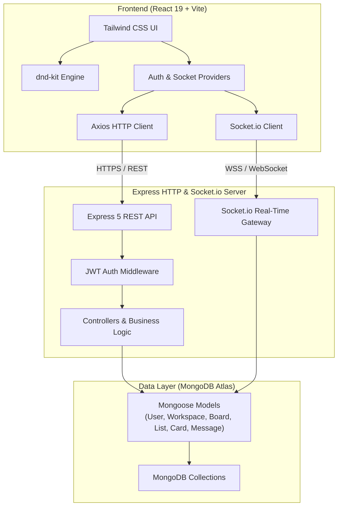

# Orbit 🪐

> **A collaborative team workspace combining fluid Kanban boards with real-time, board-scoped chat.** Manage tasks and communicate synchronously with your team in one unified interface.

[](https://react.dev/)
[](https://vitejs.dev/)
[](https://nodejs.org/)
[](https://expressjs.com/)
[](https://www.mongodb.com/)
[](https://socket.io/)
[](https://tailwindcss.com/)
[](https://opensource.org/licenses/ISC)

---

## 📌 Table of Contents

- [Overview](#-overview)
- [Key Features](#-key-features)
- [System Architecture](#-system-architecture)
- [Tech Stack](#-tech-stack)
- [Project Structure](#-project-structure)
- [Getting Started](#-getting-started)
  - [Prerequisites](#prerequisites)
  - [1. Clone the Repository](#1-clone-the-repository)
  - [2. Backend Setup](#2-backend-setup)
  - [3. Frontend Setup](#3-frontend-setup)
- [Environment Variables](#-environment-variables)
- [REST API Reference](#-rest-api-reference)
- [Real-Time WebSocket Events](#-real-time-websocket-events)
- [Deployment Guide](#-deployment-guide)
- [Roadmap](#-roadmap)
- [Contributing](#-contributing)
- [License & Author](#-license--author)

---

## 🚀 Overview

Modern engineering and product teams frequently suffer from **tool fragmentation**: project state lives inside task boards like Trello or Jira, while fast-paced team communication takes place in external channels like Slack or Discord. Crucial context is scattered across disparate browser tabs.

**Orbit** unifies project execution with live team dialogue:
- **Interactive Kanban Boards**: Organize workflows visually with smooth drag-and-drop cards and customizable lists.
- **Synchronized Board Chat**: Discuss requirements and coordinate updates directly alongside your cards in real time with WebSocket persistence.
- **Granular Workspaces**: Isolate projects by team or initiative with member invites and membership-based access boundaries.

---

## ✨ Key Features

### 📋 Agile Kanban Board Management
- **Multi-List Workflows**: Add, rename, and delete custom columns with automatic position indexing.
- **Fluid Drag-and-Drop (`@dnd-kit`)**: Reorder cards within columns and move tasks seamlessly across different lists with smooth physics and drag overlays.
- **Position Persistence**: Positional updates are batch-synchronized using MongoDB bulk operations to guarantee ordering persistence across reloads.
- **Detailed Card Modal**: Inspect and update card titles and rich descriptions on demand.

### 💬 Real-Time Board-Scoped Chat
- **Instant Communication**: Socket.io-powered room channels scoped strictly per board (`join-board` / `leave-board`).
- **Persistent Message History**: Messages are stored in MongoDB and hydrated on room load with author metadata.
- **Live Connection Feedback**: Visual indicators displaying real-time WebSocket connection state (`Live` vs. `Connecting`).
- **Responsive Drawer UI**: Sleek slide-out chat sidebar with mobile backdrop overlay and auto-scroll message feeds.

### 🏢 Workspaces & Collaboration
- **Multi-Workspace Hub**: Create distinct workspaces with dedicated project boards.
- **Member Invitation System**: Invite registered team members via email with duplicate checks and validation.
- **Workspace-Level Authorization**: Enforce member validation across boards, lists, cards, and live chat rooms.

### 🔒 Enterprise-Grade Security
- **JWT Authentication**: Secure, stateless user authentication with salted password hashing via `bcryptjs`.
- **Protected API Endpoints**: Centralized bearer token authorization middleware for all private routes.
- **Authenticated Sockets**: Connection-level JWT handshake verification ensuring only authorized users access socket channels.

### 🎨 Premium Aesthetics
- **Bespoke Dark Palette**: Tailored Tailwind CSS v4 design system with custom surfaces, borders, and ambient glassmorphism.
- **Micro-interactions & UX**: Customized scrollbars, loading skeletons, responsive modal dialogs, and smooth layout transitions.

---

## 🏗 System Architecture

Orbit uses a decoupled, event-driven client-server architecture:



---

## 🛠 Tech Stack

### Frontend
| Technology | Description |
|---|---|
| **React 19** | Component-driven UI library leveraging modern hooks and context |
| **Vite 8** | Next-generation frontend build tool with instantaneous HMR |
| **Tailwind CSS v4** | Utility-first CSS styling engine with custom theme tokens |
| **@dnd-kit** | Accessible, lightweight, high-performance drag-and-drop primitives |
| **React Router v7** | Declarative client-side routing and protected navigation |
| **Socket.io Client** | Real-time bidirectional client socket connection |
| **Axios** | Promise-based HTTP client with automatic JWT bearer interceptors |

### Backend
| Technology | Description |
|---|---|
| **Node.js (>= 18)** | Asynchronous server-side JavaScript runtime |
| **Express 5** | Minimalist web application framework for REST APIs |
| **Socket.io 4** | Real-time, event-based communication engine with fallback polling |
| **MongoDB & Mongoose 9** | NoSQL document database with schema validation and indexing |
| **JSON Web Tokens (JWT)** | Stateless security tokens for user identity verification |
| **Bcryptjs** | Cryptographic salted hashing for user credentials |
| **CORS** | Cross-Origin Resource Sharing middleware supporting multi-origin deployments |

---

## 📂 Project Structure

```
Orbit/
├── client/                           # React + Vite Frontend
│   ├── public/                       # Static public assets
│   ├── src/
│   │   ├── api/                      # Modular Axios API service functions
│   │   │   ├── axios.js              # Base client with auth interceptor
│   │   │   ├── auth.js               # Authentication endpoints
│   │   │   ├── boards.js             # Board endpoints
│   │   │   ├── cards.js              # Card CRUD & reorder endpoints
│   │   │   ├── lists.js              # List CRUD & reorder endpoints
│   │   │   ├── messages.js           # Chat message endpoints
│   │   │   └── workspaces.js         # Workspace & member endpoints
│   │   ├── components/               # Reusable UI component modules
│   │   │   ├── board/                # ListColumn, CardItem, CardModal
│   │   │   ├── chat/                 # ChatPanel, MessageList, MessageItem, MessageInput
│   │   │   └── workspace/            # InviteMemberModal
│   │   ├── context/                  # React Contexts (AuthContext, SocketContext)
│   │   ├── hooks/                    # Custom hooks (useSocket)
│   │   ├── pages/                    # Route views (Login, Signup, Dashboard, WorkspacePage, BoardPage)
│   │   ├── App.jsx                   # Root routing & protected route wrappers
│   │   ├── index.css                 # Global theme variables & scrollbar styles
│   │   └── main.jsx                  # Application entry point
│   ├── .env.example                  # Client environment variable template
│   ├── package.json                  # Client dependencies & scripts
│   ├── vercel.json                   # Vercel SPA routing rewrites configuration
│   └── vite.config.js                # Vite build configuration
│
├── server/                           # Node.js + Express + Socket.io Backend
│   ├── config/
│   │   └── db.js                     # MongoDB connection handler
│   ├── controllers/                  # Route controller logic & database queries
│   │   ├── authController.js         # Signup, login, identity queries
│   │   ├── boardController.js        # Board creation and retrieval
│   │   ├── cardController.js         # Card CRUD & position reordering algorithms
│   │   ├── listController.js         # List CRUD & column reordering
│   │   ├── messageController.js      # Message retrieval & pagination
│   │   └── workspaceController.js    # Workspace CRUD & member management
│   ├── middleware/
│   │   └── authMiddleware.js         # JWT verification & request user hydration
│   ├── models/                       # Mongoose Schemas & compound indexes
│   │   ├── Board.js
│   │   ├── Card.js
│   │   ├── List.js
│   │   ├── Message.js
│   │   ├── User.js
│   │   └── Workspace.js
│   ├── routes/                       # Express REST router definitions
│   ├── sockets/
│   │   └── chatHandler.js            # Socket.io room events & handshake verification
│   ├── .env.example                  # Server environment variable template
│   ├── package.json                  # Server dependencies & scripts
│   └── server.js                     # Main server entry & HTTP/WebSocket binding
│
├── .gitignore                        # Git ignore rules
└── README.md                         # Project documentation
```

---

## ⚡ Getting Started

Follow these instructions to run Orbit on your local machine for development and testing.

### Prerequisites

Ensure you have the following installed on your machine:
- **Node.js** (v18.0.0 or higher) → [Download Node.js](https://nodejs.org/)
- **npm** (v9.0.0 or higher) or **yarn**
- **MongoDB** instance (Local MongoDB server or a free [MongoDB Atlas](https://www.mongodb.com/atlas/database) cloud cluster)

---

### 1. Clone the Repository

```bash
git clone https://github.com/Akshat449/orbit.git
cd orbit
```

---

### 2. Backend Setup

1. Navigate to the `server` directory:
   ```bash
   cd server
   ```

2. Install dependencies:
   ```bash
   npm install
   ```

3. Configure environment variables:
   ```bash
   cp .env.example .env
   ```
   Open `.env` and configure your credentials:
   ```env
   PORT=5000
   MONGO_URI=mongodb+srv://<username>:<password>@cluster.mongodb.net/orbit?retryWrites=true&w=majority
   JWT_SECRET=your_super_secret_jwt_key
   CLIENT_URL=http://localhost:5173
   ```

4. Start the backend development server:
   ```bash
   npm run dev
   ```
   *The server will boot on `http://localhost:5000` with hot-reloading via nodemon.*

---

### 3. Frontend Setup

1. Open a new terminal and navigate to the `client` directory:
   ```bash
   cd client
   ```

2. Install dependencies:
   ```bash
   npm install
   ```

3. Configure environment variables:
   ```bash
   cp .env.example .env
   ```
   Open `.env` and verify the API endpoints:
   ```env
   VITE_API_URL=http://localhost:5000/api
   VITE_SOCKET_URL=http://localhost:5000
   ```

4. Launch the Vite development server:
   ```bash
   npm run dev
   ```
   *The client will launch at `http://localhost:5173`.*

---

## ⚙️ Environment Variables

### Backend (`server/.env`)

| Variable | Type | Description | Default / Example |
|---|---|---|---|
| `PORT` | Number | Port on which the Express server listens | `5000` |
| `MONGO_URI` | String | MongoDB connection URI string | `mongodb+srv://...` |
| `JWT_SECRET` | String | Secret key used to sign and verify JWT tokens | `your_secret_key` |
| `CLIENT_URL` | String | Allowed client origins for CORS *(comma-separated for multiple)* | `http://localhost:5173,https://your-orbit.vercel.app` |

### Frontend (`client/.env`)

| Variable | Type | Description | Default / Example |
|---|---|---|---|
| `VITE_API_URL` | String | Base HTTP URL for the REST API | `http://localhost:5000/api` |
| `VITE_SOCKET_URL` | String | Base WebSocket URL for Socket.io | `http://localhost:5000` |

---

## 📡 REST API Reference

All protected endpoints require an `Authorization: Bearer <token>` header.

### Authentication (`/api/auth`)
| Method | Endpoint | Access | Description |
|---|---|---|---|
| `POST` | `/api/auth/register` | Public | Register a new user (`name`, `email`, `password`) |
| `POST` | `/api/auth/login` | Public | Authenticate existing user and return JWT |
| `GET` | `/api/auth/me` | Protected | Retrieve authenticated user profile |

### Workspaces (`/api/workspaces`)
| Method | Endpoint | Access | Description |
|---|---|---|---|
| `GET` | `/api/workspaces` | Protected | Get all workspaces where user is a member |
| `POST` | `/api/workspaces` | Protected | Create a new workspace (`name`, `description`) |
| `GET` | `/api/workspaces/:workspaceId/members` | Protected | Fetch all members and owner of a workspace |
| `POST` | `/api/workspaces/:workspaceId/members` | Protected | Add a member by email (`email`) |

### Boards (`/api/workspaces/:workspaceId/boards`)
| Method | Endpoint | Access | Description |
|---|---|---|---|
| `GET` | `/api/workspaces/:workspaceId/boards` | Protected | Get all boards for a specific workspace |
| `POST` | `/api/workspaces/:workspaceId/boards` | Protected | Create a new board (`title`) |

### Lists (`/api/boards/:boardId/lists`)
| Method | Endpoint | Access | Description |
|---|---|---|---|
| `GET` | `/api/boards/:boardId/lists` | Protected | Get all lists on a board sorted by position |
| `POST` | `/api/boards/:boardId/lists` | Protected | Create a new list (`title`) |
| `PUT` | `/api/boards/:boardId/lists/reorder` | Protected | Reorder list columns (`orderedListIds: string[]`) |
| `PUT` | `/api/boards/:boardId/lists/:listId` | Protected | Update list title (`title`) |
| `DELETE` | `/api/boards/:boardId/lists/:listId` | Protected | Delete list and its associated cards |

### Cards (`/api`)
| Method | Endpoint | Access | Description |
|---|---|---|---|
| `GET` | `/api/boards/:boardId/cards` | Protected | Fetch all cards for a board |
| `POST` | `/api/lists/:listId/cards` | Protected | Create a new card in a list (`title`, `description`) |
| `PUT` | `/api/cards/reorder` | Protected | Reorder or move card across lists (`cardId`, `sourceListId`, `destListId`, `newPosition`) |
| `PUT` | `/api/cards/:cardId` | Protected | Update card details (`title`, `description`) |
| `DELETE` | `/api/cards/:cardId` | Protected | Delete a card and shift subsequent positions |

### Messages (`/api/boards/:boardId/messages`)
| Method | Endpoint | Access | Description |
|---|---|---|---|
| `GET` | `/api/boards/:boardId/messages` | Protected | Fetch chronological message history for a board |

---

## 🔄 Real-Time WebSocket Events

Socket.io enables instant, bidirectional collaboration across boards:

### Connection Authentication
Client handshakes supply the JWT in `socket.handshake.auth.token`. Sockets lacking a valid token are rejected before connection acceptance.

| Event Name | Direction | Payload | Description |
|---|---|---|---|
| `join-board` | Client ➔ Server | `boardId: string` | Joins a board's dedicated socket room after verifying workspace membership |
| `leave-board` | Client ➔ Server | `boardId: string` | Leaves the board room when navigating away |
| `send-message` | Client ➔ Server | `{ boardId, content }` | Persists message to MongoDB and broadcasts to room members |
| `new-message` | Server ➔ Client | `Message` object | Emitted to all clients in `boardId` room with populated sender details |

---

## 🌐 Deployment Guide

### Deploying the Backend (Render / Railway / VPS)

1. **Host on Render / Railway**:
   - Create a new **Web Service** connected to your GitHub repository.
   - Set the **Root Directory** to `server`.
   - **Build Command**: `npm install`
   - **Start Command**: `npm start` (or `node server.js`)
2. **Environment Variables**:
   - Add `PORT`, `MONGO_URI`, `JWT_SECRET`, and `CLIENT_URL` (set to your production frontend URL).
3. **Verify Health**:
   - Navigating to `https://your-api.onrender.com/` should respond with `Hello World!`.

### Deploying the Frontend (Vercel)

1. **Import Project to Vercel**:
   - Connect your GitHub repository.
   - Set **Root Directory** to `client`.
   - Framework preset: **Vite**.
2. **SPA Routing**:
   - The included [`client/vercel.json`](client/vercel.json) automatically handles client-side route rewrites:
     ```json
     {
       "rewrites": [
         { "source": "/(.*)", "destination": "/index.html" }
       ]
     }
     ```
3. **Environment Variables**:
   - Add `VITE_API_URL` → `https://your-api.onrender.com/api`
   - Add `VITE_SOCKET_URL` → `https://your-api.onrender.com`
4. **Deploy**:
   - Trigger build and verify real-time chat & board sync over HTTPS/WSS.

---

## 🗺 Roadmap

- [x] **Phase 1: Foundation & Core Collaboration**
  - [x] JWT-based Authentication & Protected Routes
  - [x] Workspace & Multi-Board Management
  - [x] Fluid Drag-and-Drop Kanban Board with `@dnd-kit`
  - [x] Column & Card Reordering with Mongo Bulk Operations
  - [x] Real-Time Board-Scoped Live Chat over Socket.io
  - [x] Workspace Member Email Invitations & Access Boundaries
  - [x] Production Cloud Deployment (Vercel + Render + MongoDB Atlas)
- [ ] **Phase 2: Enhanced Task Context & Interactivity**
  - [ ] Color-coded Labels & Tag Filtering
  - [ ] Due Dates with Overdue Visual Warnings
  - [ ] Checklists / Subtasks progress indicators
  - [ ] Card comment threads & activity log audit trails
  - [ ] @mention parsing & user notification toasts
- [ ] **Phase 3: Real-Time Audio & Video**
  - [ ] WebRTC 1:1 Voice and Video Calling via simple-peer / PeerJS
  - [ ] Screen sharing & call controls inside board rooms

---

## 🤝 Contributing

Contributions, feedback, and issue reports are welcome!

1. **Fork the Repository**
2. **Create a Feature Branch** (`git checkout -b feature/AmazingFeature`)
3. **Commit your Changes** (`git commit -m 'Add some AmazingFeature'`)
4. **Push to the Branch** (`git push origin feature/AmazingFeature`)
5. **Open a Pull Request**

---

## 📄 License & Author

Distributed under the **ISC License**.

Developed by **[Akshat Kumar](https://github.com/Akshat449)**
- GitHub: [@Akshat449](https://github.com/Akshat449)
- Project Repository: [https://github.com/Akshat449/orbit](https://github.com/Akshat449/orbit)
